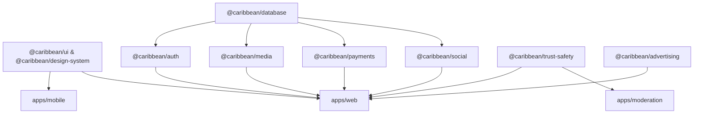

# TUKUBI Master Platform Maturity Audit — Stage A Baseline & Feature Inventory

**Document Reference:** `AUDIT/38_TRUST_SIGNUP_FEED_PLATFORM_MATURITY_STAGE_A_BASELINE.md`  
**Platform Identity:** TUKUBI — *The Caribbean Connected. Born in the Caribbean. Built for the World.*  
**Production URL:** https://www.tukubi.com/  
**Audit Date:** October 29, 2026  
**Auditor:** Coordinated Principal Engineering, Product Design, Privacy, Security, QA & Platform Architecture Team  
**Quality Gate Status:** Verified Against Live Remote & Local AST

---

## 1. Executive Summary & Baseline Objectives

This document establishes the empirical, zero-assumption baseline of the TUKUBI platform across its web application (`apps/web`), mobile suite (`apps/mobile`), companion studios (`apps/admin`, `apps/moderation`, `apps/creator-studio`, `apps/business-studio`), 25 shared packages (`packages/*`), 115 Supabase PostgreSQL migrations, and deployed production infrastructure.

The platform is running Next.js 15 App Router behind Cloudflare Edge and Vercel hosting, connected to Supabase PostgreSQL with strict Row Level Security (RLS) and double-entry financial ledger accounting.

### Key Verified Metrics
- **Automated Test Suite:** 2,299 tests across 213 test files (`ALL PASS`, 0 failures, 0 skipped).
- **TypeScript Packages:** 31 workspace projects typechecked (`turbo run typecheck` zero errors).
- **Database Migrations:** 115 sequential versioned migrations in `supabase/migrations/` (latest `00115_security_ads_and_rpc_hardening.sql`).
- **Deployed Production Envelope:** HTTPS, strict CSP (whitelisting Supabase, Stripe, PayPal, Mux, Cloudflare, OpenRouter, YouTube, Vimeo, TikTok), HSTS (63,072,000s with preload), `X-Frame-Options: DENY`, `X-Content-Type-Options: nosniff`, and edge rate-limiting (120 req/min).

---

## 2. Comprehensive Inventory of Routes, Screens & Applications

### 2.1 Web Application (`apps/web`)

| Route Group | Path | Rendering Mode | Purpose & User Journey | Key Components |
|---|---|---|---|---|
| **Public Front Door** | `/` (unauthenticated) | SSR | Gateway landing, cultural manifesto, carousel, value proposition | `public-front-door.tsx`, `caribbean-sunset-background.tsx` |
| **Unified Home Feed** | `/` (authenticated) | Dynamic SSR + RSC | 5-tab stream (For You, Friends, Following, Communities, Islands) | `home-dashboard.tsx`, `feed-stream.tsx`, `feed-post.tsx`, `home-rail.tsx` |
| **Registration & Onboarding** | `/signup`, `/signup/*` | Client | 5-step cultural onboarding (Intent, Island Roots, Identity, Vibes, Complete) | `GatewayShell.tsx`, `StepProgress.tsx`, `TukubiCulturalPassport.tsx` |
| **Authentication & Gateways** | `/login`, `/auth/callback`, `/forgot-password`, `/reset-password` | Hybrid SSR/Client | Credential & OAuth sign-in, session recovery, sanitization gate | `login/page.tsx`, `auth/callback/route.ts`, `redirect-utils.ts` |
| **Dedicated Shorts / Reels** | `/shorts`, `/reels` | Dynamic SSR | Dedicated vertical short-video destination, auto-play, creator follow, comments | `shorts-feed-viewer.tsx`, `short-card.tsx`, `reels-feed-viewer.tsx` |
| **Messaging & Voice Calling** | `/messages`, `/messages/[id]` | Dynamic SSR + Realtime | Direct, group, and business messaging, voice notes, WebRTC P2P audio/video calls | `messages-shell.tsx`, `message-thread.tsx`, `audio-voice-note-player.tsx`, `call-modal.tsx` |
| **Personal Profiles** | `/profile`, `/profile/[username]` | Dynamic SSR | User identity, Cultural Passport, follower graph, personal feed, friends tab | `profile-edit-modal.tsx`, `profile-friends-tab.tsx`, `avatar-upload.tsx` |
| **Universal Pages** | `/pages`, `/pages/[slug]` | Dynamic SSR | Creator, business, brand, and cultural organization public storefronts & posts | `page-detail-client.tsx`, `identity-switcher.tsx`, `page-post-composer.tsx` |
| **Universal Creation Hub** | `/create` | Client | Universal multi-type post & media publisher (Story, Reel, Post, Product, Event) | `create-hub-client.tsx`, `universal-composer.tsx`, `draft-manager.ts` |
| **Marketplace & Stores** | `/marketplace`, `/stores/[slug]` | Dynamic SSR | Island commerce, merchant storefronts, escrow checkout, currency conversion | `marketplace-grid.tsx`, `storefront-view.tsx`, `product-card.tsx` |
| **Cultural Events & Tickets** | `/events`, `/events/[id]` | Dynamic SSR | Island festival, carnival, concert discovery, RSVP tracking, digital passes | `events-view.tsx`, `interactive-event-card.tsx` |
| **Caribbean Sounds** | `/sounds`, `/sounds/[id]` | Dynamic SSR | Audio tracks, original island sounds, viral short-video audio attribution | `sounds-hub.tsx`, `sound-detail-viewer.tsx`, `tukubi-audio-player.tsx` |
| **Podcasts Network** | `/podcasts`, `/podcasts/[id]` | Dynamic SSR | Caribbean audio journalism, episode players, RSS syndication feeds | `podcast-network-feed.tsx`, `podcast-player.tsx` |
| **Live Broadcast Studio** | `/live`, `/live/[id]` | Dynamic SSR + WebRTC | Live video broadcasting, dual-host co-streaming, real-time interactive chat | `live-studio-broadcaster.tsx`, `live-viewer-player.tsx` |
| **Communities & Groups** | `/communities`, `/communities/[slug]` | Dynamic SSR | Island diaspora hubs, interest groups, community membership, scoped feeds | `communities-client.tsx`, `community-detail-view.tsx` |
| **Islands & Diaspora Hub** | `/islands`, `/culture` | Dynamic SSR | Country/territory drilldown across 30+ Caribbean jurisdictions | `island-selector.tsx`, `islands-client.tsx` |
| **TUKUBI Ads Manager** | `/ads`, `/ads/create`, `/ads/[id]`, `/ads/billing` | Dynamic SSR | Campaign creation, creative preview, PayPal funding, analytics dashboard | `campaign-row.tsx`, `fund-campaign-button.tsx`, `ad-preview-card.tsx` |
| **Financial Wallet** | `/wallet` | Dynamic SSR | Multi-currency balance, earnings, tips, payout requests, ledger view | `wallet-dashboard.tsx`, `tip-modal.tsx` |
| **Settings & Privacy Center**| `/settings` | Client / SSR | Profile, security, notification prefs, appearance, language, data export | `settings-view.tsx`, `settings-actions.ts` |
| **Help & Support Center** | `/help`, `/help/*`, `/learn` | Static/SSR | 12 support categories, knowledgebase search, feedback, ticket submission | `help-search.tsx`, `articles-data.ts` |
| **CaribAI Assistant** | `/carib-ai` | Client | AI conversational assistant, dialect caption generator, advertising helper | `carib-ai-chat.tsx`, `dialect-caption-generator.tsx` |
| **Legal & Policies** | `/terms`, `/privacy`, `/standards` | Static SSR | Terms of Service, Privacy Policy, Community Standards | `terms/page.tsx`, `privacy/page.tsx` |

### 2.2 Companion Applications
- **`apps/mobile`**: Universal React Native Expo application (iOS & Android) with native bottom tab navigation, camera capture, safe-area containment, and push notifications.
- **`apps/admin`**: Super-admin console for global platform telemetry, jurisdiction rule management, dispute arbitration, and infrastructure monitoring.
- **`apps/moderation`**: Specialized trust & safety portal for content review, user reports, automated AI flags, and ad campaign approval workflows.
- **`apps/creator-studio`**: Advanced publisher suite for audio mixing, video transcoding analytics, subscriber tiers, and payout reconciliation.
- **`apps/business-studio`**: Enterprise operations console for multi-location inventory, staff role assignments, advertising campaigns, and customer support.

---

## 3. Packages Architecture & Shared Abstractions

The monorepo enforces clean boundaries across 25 `@caribbean/*` packages:

1. **`@caribbean/design-system`**: Predefined design tokens for Caribbean Futurism (`sunriseCoral`, `caribbeanSea`, `goldenHour`, `twilight`, `sandstone`).
2. **`@caribbean/database`**: Typed Supabase query wrappers, cursor encoding/decoding, pagination helpers.
3. **`@caribbean/payments`**: Double-entry ledger engine, PayPal Orders v2 adapter, idempotency guards, escrow pipeline.
4. **`@caribbean/media`**: Universal content resolver, SSRF guard, oEmbed adapters (YouTube, TikTok, Facebook, Instagram, Vimeo, X), image optimization.
5. **`@caribbean/social`**: Feed mode definitions (`for_you`, `friends`, `following`, `communities`, `islands`), reaction taxonomy, engagement hydration.
6. **`@caribbean/auth`**: Session storage, redirect sanitization, RBAC role validation, signup state management.
7. **`@caribbean/trust-safety`**: Moderation case engine, content filter heuristics, report routing, risk scoring.
8. **`@caribbean/advertising`**: Campaign budget tracking, server-side CPM calculations, ad event logging.
9. **`@caribbean/localization`**: 6 Caribbean language locales (`en`, `es`, `fr`, `ht`, `nl`, `pap`) with native translation dictionaries.

---

## 4. Database Schema, Migrations & RLS Architecture Baseline

- **Total Migrations:** 115 versioned SQL files located in `supabase/migrations/`.
- **Core Entities:** `profiles`, `profile_identity`, `parental_consent_requests`, `posts`, `post_media`, `post_likes`, `post_comments`, `saved_posts`, `videos`, `video_views`, `video_saves`, `video_shares`, `businesses` (Pages), `page_roles`, `page_followers`, `conversations`, `messages`, `campaigns`, `ad_sets`, `ads`, `wallets`, `transactions`, `ledger_entries`, `payment_intents`.
- **Row Level Security (RLS):** 100% of tables exposed to client software have `ENABLE ROW LEVEL SECURITY` with granular policies.
- **Double-Entry Financial Integrity:** Inviolable rule enforced in migration `00115` and `packages/payments`. No mutable increments (`balance = balance + X`) exist; every payment intent, ad spend, and tip generates paired debit/credit records with unique idempotency keys.

---

## 5. Confirmed vs. Suspected Defects & Critical Gaps

Following detailed inspection of the live deployment, source files, and database schemas, the following findings are confirmed:

| ID | Category | Severity | Confirmed Condition | Technical Impact | Remediation Plan |
|---|---|---|---|---|---|
| **GAP-01** | Signup & Compliance | **P0 / High** | `apps/web/src/app/signup/account/page.tsx` does not collect `date_of_birth`, despite the DB schema (`00075`) having `date_of_birth` and `age_tier` triggers. | Users register with `age_tier: 'unverified'`, bypassing child safety gates (Dominican Republic Law 136-03, COPPA, GDPR-K). | Add accessible DOB collection in signup, calculate age tier client & server side, block < 13 without parental consent, engage minor safeguards for 13–17. |
| **GAP-02** | Legal Consent | **P0 / High** | Signup checkbox only sets client boolean `agreeTerms` without persisting versioned, auditable consent records in the database. | Inability to prove compliance with DR Law 126-02 (electronic consent) or GDPR Art. 7 (burden of proof for consent). | Create `legal_consent_records` table (`00116`), record document version (`2026.1`), timestamp, user ID, and separate marketing consent. |
| **GAP-03** | Account Deletion | **P1 / High** | In `settings-view.tsx`, "Confirm Delete" under "Permanently Delete Account" calls `deactivateAccountAction()`, only setting `status: 'deactivated'`. | Misleads user into believing data was erased; fails Right to Erasure (Law 172-13 Art. 5, GDPR Art. 17). | Create `account_deletion_requests` table (`00116`), implement 30-day grace period, lawful financial retention exceptions, and scheduled purge pipeline. |
| **GAP-04** | Consent Separation | **P1 / Medium** | Marketing communications consent is implicitly bundled or absent during registration. | Violates DR Pro-Consumidor (Law 358-05) and international opt-in standards. | Add separate, unbundled optional marketing checkbox during signup and record in `legal_consent_records`. |
| **GAP-05** | Mobile Nav Parity | **P2 / Medium** | `MobileNav` has 5 tabs (`Home`, `Explore`, `Create`, `Messages`, `Profile`), while `Shorts` is nested within create sheet or explore. | Shorts is a primary pillar in Caribbean culture & youth engagement (TikTok reference); lacks 1-tap mobile bottom tab presence. | Refine mobile navigation to provide prominent 1-tap Shorts access. |
| **GAP-06** | Data Export Completeness | **P2 / Medium** | `exportAccountDataAction` only exports up to 100 posts, profiles, and prefs, omitting media assets, comments, and relationship counts. | Incomplete data portability package under Law 172-13 and GDPR Art. 20. | Expand `exportAccountDataAction` to include user-authored comments, media URLs, reaction logs, and cultural preferences. |

---

## 6. Stage A Acceptance Decision

Stage A baseline discovery is complete. The platform has high code quality, zero TypeScript errors, and passing unit/RLS test suites. The identified gaps are strictly structural and legal/compliance enhancements that can be remediated in versioned migration `00116` and small, targeted frontend/backend improvements without regression or data destruction.
