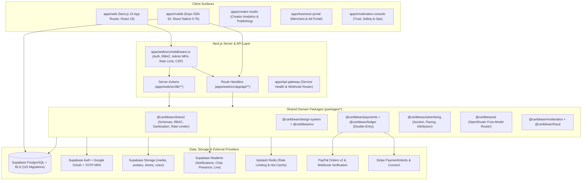

# SYSTEM_ARCHITECTURE — TUKUBI

## 1. High-Level Topology

TUKUBI is structured as a **Turborepo + pnpm (`pnpm@10.0.0`, Node `>=22.0.0`) monorepo** comprising **6 applications** (`apps/*`), **25 domain and infrastructure packages** (`packages/*`), and a versioned **Supabase PostgreSQL** backend (`supabase/migrations/00001` through `00115`).

---

## 2. Application Layer (`apps/`)

| Application | Package Name | Tech Stack | Role & Authority |
|---|---|---|---|
| `apps/web` | `caribbean-web` | Next.js 15.2, React 19, Tailwind CSS, Supabase SSR | **Primary authoritative web application** (`https://www.tukubi.com/`). Hosts 57 page routes, 36 API routes, and 27 server action modules. |
| `apps/mobile` | `@caribbean/mobile` | Expo SDK 52, React Native 0.76 | Universal iOS & Android application with 22 screens (`HomeFeedScreen`, `ReelsScreen`, `MessagesScreen`, `CommunitiesScreen`, `FinancialCenterScreen`, etc.) and Store-compliant IAP routing. |
| `apps/api-gateway` | `@caribbean/api-gateway` | Node.js HTTP Service | Standalone gateway health check, rate-limiting proxy, and webhook ingress service. |
| `apps/business-portal` | `@caribbean/business-portal` | Next.js 15 | Dedicated workspace for merchant inventory, order fulfillment, and business metrics. |
| `apps/creator-studio` | `@caribbean/creator-studio` | Next.js 15 | Dedicated creator analytics, audience growth, and payout management workspace. |
| `apps/moderation-console` | `@caribbean/moderation-console` | Next.js 15 | Internal Trust & Safety queue, appeal review, and platform governance console. |

---

## 3. Request Lifecycle & Security Boundary (`apps/web/src/middleware.ts`)

Every incoming web request passes through `apps/web/src/middleware.ts`:
1. **Correlation & Tracing:** Assigns or propagates `x-request-id` (`UUIDv4`) across request and response headers.
2. **Sliding-Window Rate Limiting:** Enforces per-IP limits on `/api/*` (`120 req/min`) and `/auth/*` (`30 req/min`).
3. **CSRF Origin Validation:** Validates `Origin` against `Host` on mutating requests (`POST`, `PUT`, `PATCH`, `DELETE`), exempting cryptographic webhook endpoints (`/api/payments/webhooks/*`).
4. **Supabase SSR Session Refresh:** Validates JWT via `supabase.auth.getUser()` and refreshes auth cookies.
5. **Protected Route Enforcement:** Redirects unauthenticated visitors from `/wallet`, `/settings`, `/messages`, `/notifications`, `/creator-studio`, `/business-suite`, `/ads/create`, and `/admin` to `/auth/sign-in`.
6. **Admin RBAC & Mandatory MFA (`AAL2`):** Queries `profiles.role` and `user_roles` for `/admin/*` and `/api/v1/admin/*`. Requires `admin` or `super_admin` role and enforces Supabase Authenticator Assurance Level `aal2` in production.
7. **Hardened Security Headers:** Emits strict `Content-Security-Policy`, `X-Frame-Options: DENY`, `X-Content-Type-Options: nosniff`, `Referrer-Policy: strict-origin-when-cross-origin`, and `Permissions-Policy`.

---

## 4. State, Caching & Realtime Architecture

- **Server-First Data Fetching:** Primary feeds (`/`, `/shorts`, `/pages/[slug]`, `/profile/[username]`, `/messages`) load initial state via React Server Components (RSC) and hydrate interactive islands via client components.
- **Feed Hydration Pipeline (`apps/web/src/lib/feed/`):**
  - `load-feed.ts` executes parallel bounded queries for posts, Page posts (`businesses!posts_page_id_fkey`), block lists (`blocks`), and moderated active ads (`moderation_status = 'approved'`).
  - `hydrate-posts.ts` batch-hydrates `post_likes`, `saved_posts`, `post_media`, and link preview metadata in a single round-trip without N+1 queries.
- **Realtime Channels (`apps/web/src/components/notifications-realtime-provider.tsx`, `message-thread.tsx`):**
  - Subscriptions are scoped to authenticated user IDs (`notifications:user_id=eq.${uid}`) and active conversation threads (`messages:conversation_id=eq.${convId}`).
- **Audio Concurrency Singleton (`apps/web/src/lib/media/audio-manager.ts`):**
  - Guarantees at most one media element (feed video, Short/Reel, podcast episode, or sound preview) plays audio at any moment across the application.
