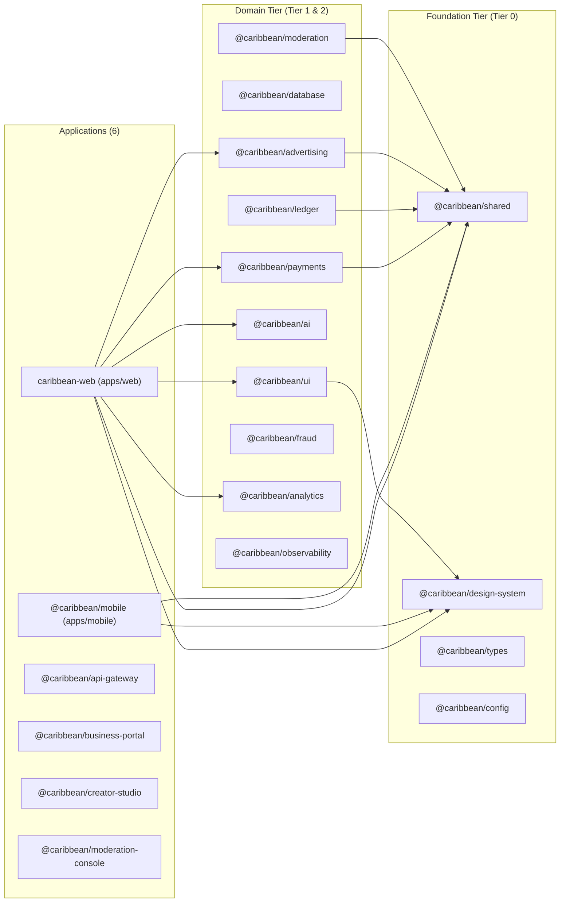

# CODEBASE_MAP — TUKUBI

> **Machine-Readable Knowledge Graph:** `TUKUBI Engineering Intelligence/03 Codebase Intelligence/graph.json` (generated deterministically by `scripts/code-intelligence/generate-codebase-graph.js` — **628 nodes**, **1,069 edges**, **0 circular workspace dependencies**).

---

## 1. Workspace Dependency Topology (`apps/*` & `packages/*`)

---

## 2. All 25 Shared Packages (`packages/*`)

| Package | Path | Internal `@caribbean/*` Deps | Primary Responsibility |
|---|---|---|---|
| `@caribbean/shared` | `packages/shared` | None (Leaf) | Zod schemas, RBAC permissions, PostgREST sanitizer, rate-limiter, idempotency, cultural constants |
| `@caribbean/design-system` | `packages/design-system` | None (Leaf) | `Island Vibes` & `Island Daylight` design tokens, typography, motion, WCAG contrast tokens |
| `@caribbean/types` | `packages/types` | None (Leaf) | Generated & canonical TypeScript database and domain interfaces |
| `@caribbean/config` | `packages/config` | None (Leaf) | Shared TypeScript, ESLint, and environment configuration presets |
| `@caribbean/ui` | `packages/ui` | `@caribbean/design-system` | Accessible shared React UI primitives |
| `@caribbean/database` | `packages/database` | `@caribbean/shared` | Supabase client factories, connection helpers, query builders |
| `@caribbean/ledger` | `packages/ledger` | `@caribbean/shared` | Immutable double-entry financial ledger engine (`debit`/`credit` balancing) |
| `@caribbean/payments` | `packages/payments` | `@caribbean/shared` | Payment Policy Engine, `PayPalAdapter`, `StripeAdapter`, `TransactionLedgerService`, `LedgerOrchestrator` |
| `@caribbean/advertising` | `packages/advertising` | `@caribbean/shared`, `@caribbean/analytics` | Second-price ad auction, budget pacing, frequency capping, attribution |
| `@caribbean/ai` | `packages/ai` | `@caribbean/shared` | OpenRouter free-model (`:free`) router, prompt injection sanitizer, translation |
| `@caribbean/moderation` | `packages/moderation` | `@caribbean/shared` | Automated text/media safety classifiers, escalation workflow |
| `@caribbean/fraud` | `packages/fraud` | `@caribbean/shared` | Velocity checks, wash-trading detection, ad-click anomaly scoring |
| `@caribbean/analytics` | `packages/analytics` | `@caribbean/shared` | Typed product telemetry & funnel event dispatcher |
| `@caribbean/observability` | `packages/observability` | `@caribbean/shared` | Structured JSON logger, OpenTelemetry trace helpers, PII redaction |
| `@caribbean/auth` | `packages/auth` | `@caribbean/shared` | Session validation, role resolution, step-up MFA helpers |
| `@caribbean/cache` | `packages/cache` | `@caribbean/shared` | Upstash Redis cache-aside & stampede protection |
| `@caribbean/commerce` | `packages/commerce` | `@caribbean/shared`, `@caribbean/payments` | Storefront catalog, cart, order state machine |
| `@caribbean/events` | `packages/events` | `@caribbean/shared` | Domain event bus and outbox pattern |
| `@caribbean/feed` | `packages/feed` | `@caribbean/shared` | Multi-stage candidate generation and cultural affinity ranking |
| `@caribbean/geo` | `packages/geo` | `@caribbean/shared` | Caribbean island/territory ISO metadata and diaspora hub mapping |
| `@caribbean/jobs` | `packages/jobs` | `@caribbean/shared` | Background job definitions and retry policies |
| `@caribbean/media` | `packages/media` | `@caribbean/shared` | Upload validation, MIME magic-byte checks, transcoding descriptors |
| `@caribbean/messaging` | `packages/messaging` | `@caribbean/shared` | Conversation state, message sequence numbering, reaction aggregation |
| `@caribbean/notifications` | `packages/notifications` | `@caribbean/shared` | Multi-channel notification templates and batching |
| `@caribbean/search` | `packages/search` | `@caribbean/shared` | Full-text search query builder and relevance ranking |

---

## 3. High-Coupling Modules & Architectural Seams (`apps/web/src`)

From `03 Codebase Intelligence/graph.json`, the highest fan-in modules in `apps/web/src` are:
1. `apps/web/src/lib/supabase/server.ts` (`createSupabaseServerClient`, `createSupabaseServiceClient`) — imported by all 27 server action modules and 36 API routes.
2. `apps/web/src/lib/auth.ts` (`getCurrentUser`) — central server-side identity resolver.
3. `apps/web/src/lib/feed/hydrate-posts.ts` (`hydratePostsEngagement`) — shared post hydration seam used by Home Feed (`/`), Profile (`/profile/[username]`), Pages (`/pages/[slug]`), and Saved Posts (`/saved`).
4. `apps/web/src/lib/media/audio-manager.ts` (`AudioManager`) — singleton coordinating audio playback across `tukubi-video-player.tsx`, `tukubi-audio-player.tsx`, `short-card.tsx`, `sound-detail-viewer.tsx`, and `podcast-network-feed.tsx`.
