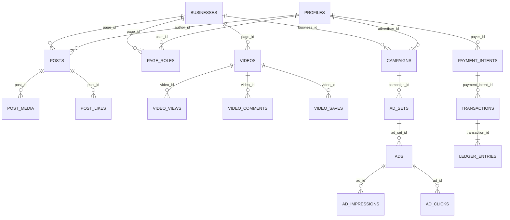

# DATA_MODEL — TUKUBI Database & RLS Architecture

## 1. Migration Lineage (`supabase/migrations/00001` – `00115`)

TUKUBI's data layer is managed exclusively via versioned SQL migrations in `supabase/migrations/` (115 migration files). Row-Level Security (`ENABLE ROW LEVEL SECURITY`) is mandatory on every client-accessible table.

### Key Recent Migrations (`00108` – `00115`)
- `00108_page_publishing_rls_and_feed_distribution.sql` & `00108_phase2_security_rls_and_publishing_lifecycle.sql`: Page roles (`page_roles`), Page followers (`page_followers`), post publishing lifecycle (`post_status`, `publisher_type`, `page_id`).
- `00109_messages_production_upgrade.sql`: Rich messaging (`message_reactions`, `message_requests`, `conversation_mutes`, `get_user_messaging_friends`).
- `00110_tukubi_shorts_upgrade.sql`: Shorts metadata (`video_kind`, `category`, `captions`, `page_id` on `videos`).
- `00111_transfer_kool_tech_page_ownership.sql`: Idempotent ownership transfer for the Kool Tech page (hardened with safe `RAISE NOTICE ... RETURN` in CI/staging environments).
- `00112_tukubi_ads_engine.sql` & `00113_tukubi_ads_self_serve_upgrade.sql`: Self-serve `campaigns`, `ad_sets`, `ads`, `ad_impressions`, `ad_clicks`, `ad_events`.
- `00114_tukubi_ads_production_hardening.sql`: Ad moderation workflow (`moderation_status`, `ad_moderation_logs`).
- **`00115_security_ads_and_rpc_hardening.sql` (Added in Giant Among Giants Transformation):**
  - Reconciles `public.posts` SELECT/INSERT/UPDATE/DELETE RLS so personal, community, and Page-published posts coexist without policy overwrite (`DB-01`).
  - Enables RLS and strict owner-only policies on all `feed_activity_timeline_*` partitions (`DB-03`).
  - Enables RLS on `public.videos`, adds immutable column trigger `enforce_video_immutable_fields`, creates `public.video_saves` and `public.video_shares`, and creates `increment_video_counter` RPC (`DB-05`).
  - Creates missing `respond_or_leave_livestream_cohost` RPC (`DB-06`).
  - Hardens `record_ad_impression_and_spend` with server-computed CPM, moderation check, 5-minute viewer deduplication, self-impression guard, and double-entry `ledger_entries` (`SEC-01`).
  - Hardens `get_user_messaging_friends`, `is_staff_or_ad_moderator`, `is_page_member`, and `can_manage_page` against IDOR (`SEC-02`, `SEC-03`, `SEC-04`).
  - Adds `enforce_campaign_and_ad_security` trigger and atomic `fund_campaign_from_intent` RPC (`SEC-03`, `P0-1`, `P0-7`).

---

## 2. Core Entity-Relationship Diagram

---

## 3. Double-Entry Financial Ledger Invariants (`AGENTS.md` Rule 3)

Every monetary movement in TUKUBI (ad campaign funding, ad impression spend, creator tipping, subscriptions, marketplace orders) adheres to strict double-entry bookkeeping in `public.transactions` and `public.ledger_entries`:

1. **Campaign Funding (`fund_campaign_from_intent` / `TransactionLedgerService`):**
   - Verified against PayPal Orders v2 capture (`status = 'COMPLETED'`).
   - Idempotency key: `settle_intent_${payment_intent.id}`.
   - Paired entries in `ledger_entries`:
     - `DEBIT` (`entry_type = 'debit'`, `amount > 0`): Platform Clearing / Settlement Account (`00000000-0000-0000-0000-000000000001`).
     - `CREDIT` (`entry_type = 'credit'`, `amount > 0`): Platform Deferred Ad Revenue / Campaign Escrow Account (`00000000-0000-0000-0000-000000000002`).
2. **Ad Impression Spend (`record_ad_impression_and_spend`):**
   - Server computes cost from `ad_sets.bid_amount_minor` (`GREATEST(1, ROUND(bid_amount_minor / 1000.0))`).
   - Deducts from unspent `funded_amount_minor - spent_amount_minor` with row-level `FOR UPDATE` lock on `campaigns`.
   - Paired entries in `ledger_entries` linked to deterministic `tx_id`:
     - `DEBIT`: Advertiser Prepaid Ad Balance.
     - `CREDIT`: TUKUBI Recognized Ad Revenue.
