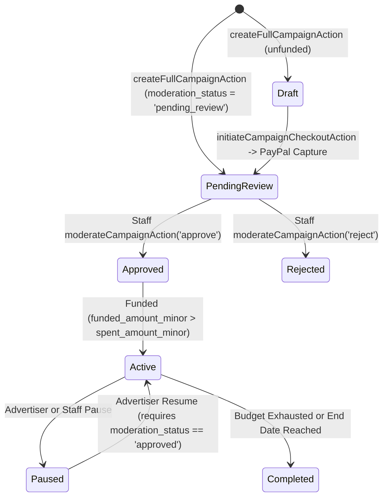

# ADVERTISING_AND_PAYPAL_ARCHITECTURE — TUKUBI

## 1. End-to-End Campaign Lifecycle & Moderation State Machine

### Mandatory Safety Invariants
1. **No Unapproved Ad Serving:** Neither `updateCampaignStatusAction` nor `loadHomeFeedPage` (`load-feed.ts`) nor `record_ad_impression_and_spend` (`00115`) will activate or serve any campaign unless `campaigns.moderation_status = 'approved'` AND `campaigns.status = 'active'` AND `campaigns.funded_amount_minor > campaigns.spent_amount_minor`.
2. **Database-Level Trigger Protection:** `enforce_campaign_and_ad_security` (`00115`) blocks non-staff users from altering `moderation_status`, `funded_amount_minor`, `spent_amount_minor`, or `payment_status` via direct PostgREST calls.

---

## 2. PayPal Order Creation, Capture & Webhook Reconciliation

1. **Order Creation (`initiateCampaignCheckoutAction`):**
   - Validates amount (`$5.00` – `$10,000.00` USD) and campaign ownership.
   - Calls `PayPalAdapter.createPayment`, which creates a PayPal v2 Order with `intent: 'CAPTURE'` and `purchase_units[0].custom_id = idempotencyKey`.
   - Inserts a `payment_intents` row with `payer_id`, `product_type: 'business_ad'`, `reference_type: 'ad_campaign'`, `reference_id: campaignId`, `provider_transaction_id: orderRes.providerReference`, and `status: 'requires_payment'`.
2. **Synchronous Redirect Capture (`/api/payments/paypal/capture`):**
   - Authenticates user and loads `payment_intents` by `intent_id`.
   - Verifies `intent.payer_id === user.id` and `intent.provider_transaction_id === token`.
   - If `intent.status === 'succeeded'`, redirects immediately (idempotent short-circuit).
   - Calls `PayPalAdapter.captureOrder(token)` and verifies captured amount and currency match `intent.amount_minor` and `intent.currency`.
   - Calls `TransactionLedgerService.recordSettledTransaction` with canonical idempotency key `settle_intent_${intent.id}` (creating `transactions` + paired debit/credit `ledger_entries`).
   - Increments `campaigns.funded_amount_minor` via `fund_campaign_from_intent` RPC (or service fallback).
3. **Asynchronous Webhook Verification (`/api/payments/webhooks/paypal`):**
   - Verifies cryptographic headers via PayPal's `/v1/notifications/verify-webhook-signature`.
   - Deduplicates event delivery in `webhook_events`.
   - On `CHECKOUT.ORDER.APPROVED`, updates status to `'processing'` without crediting funds.
   - On `PAYMENT.CAPTURE.COMPLETED`, resolves the `payment_intent`, checks `intent.status !== 'succeeded'`, settles via the same `settle_intent_${intent.id}` key, and funds the campaign idempotently.
