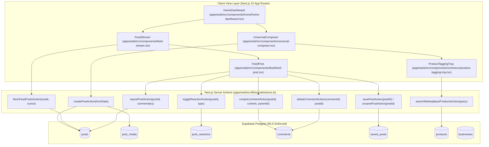

# Specification: Core Feed & Live Post Composer (The X / Facebook Core)

**Date**: 2026-11-07  
**Status**: Approved (Phase 1 of Social Media Platform Modernization)  
**Target Systems**: `apps/web`, `packages/social`, `packages/marketplace`, `packages/database`, Supabase Schema  
**Reverse-Engineered References**: X (Twitter) & Facebook

---

## 1. Executive Summary & Goals

Tukubi is transitioning all core social interactive surfaces from prototype/mock fallbacks to 100% production-grade live operations. This specification establishes the architecture for **Sub-Project 1: Core Feed & Live Post Composer**, adopting a **Caribbean Futurism Hybrid Model** reverse-engineered from X (Twitter) and Facebook:
- **From X**: Keyset cursor timeline streaming, floating *"↑ N New Posts"* pill over Supabase Realtime, optimistic instant posting, Quote Post cards, and high-velocity keyboard/UI responsiveness.
- **From Facebook**: 5-emotion multi-reaction drawer (*Like, Vibe, Fire, Respect, Laugh*), 2-level threaded comments, and rich publisher drawers (product tagging, link previews, island nation badges).
- **Inviolable Principle**: **Zero Mock Data**. All mock catalogs (specifically `DEFAULT_CARIBBEAN_PRODUCTS` in `product-tagging-tray.tsx`) are excised and replaced with live Supabase database queries and resilient empty states.

---

## 2. System Architecture & Component Hierarchy



---

## 3. Detailed Component Specifications

### 3.1. Zero-Mock Marketplace Product Tagging
- **Current Defect**: `product-tagging-tray.tsx` defines a hardcoded array `DEFAULT_CARIBBEAN_PRODUCTS` (e.g., *Blue Mountain Peaberry Coffee*, *St. Lucian Organic Cocoa Sticks*).
- **Remediation**:
  1. Deprecate and remove `DEFAULT_CARIBBEAN_PRODUCTS`.
  2. Implement `searchMarketplaceProductsAction(query?: string, limit = 10)` in `apps/web/src/lib/commerce/actions.ts` (or `apps/web/src/lib/marketplace/actions.ts`).
  3. Query Supabase table `products` joined with `businesses`:
     ```sql
     SELECT p.id, p.title, p.price_minor, p.currency, p.thumbnail_url, p.is_available,
            b.name AS seller_name, b.id AS seller_id, b.country_iso AS origin_country
     FROM products p
     JOIN businesses b ON p.business_id = b.id
     WHERE p.is_active = true
       AND (query IS NULL OR p.title ILIKE '%' || query || '%')
     ORDER BY p.created_at DESC
     LIMIT limit;
     ```
  4. If no products are in the database, display an authentic Caribbean empty state:
     *"No marketplace products found. Local merchants can list authentic products in the Business Studio."*

### 3.2. UniversalComposer & Publishing Lifecycle
- **Idempotency**: Client generates a unique UUID `idempotency_key` stored in the form data. If network retries occur, the database query catches the key and returns the created post without duplication.
- **Quote Post Integration**:
  - When quoting an existing post, `shared_post_id` is set on the new post.
  - The composer displays a compact read-only preview of the quoted author, handle, content snippet, and media thumbnail.
  - `posts.shared_post_id` and `posts.share_commentary` are persisted in Supabase.
- **Media Upload Flow**:
  - Images and video snippets are processed client-side (`normalizeExifAndCompressImage`).
  - Uploads stream directly to Supabase Storage bucket (`media` or `posts`).
  - Storage paths and resolved public URLs are populated in `post_media` rows on submit.
- **Non-blocking Link Previews**:
  - URLs detected in content trigger async OpenGraph metadata resolution without blocking submission.

### 3.3. FeedStream & Keyset Pagination
- **Cursor Mechanism**:
  - Encoded cursor string: `encodeCursor({ sortKey: post.created_at, id: post.id })`.
  - Pagination condition: `post.created_at < cursor.sortKey`.
  - Avoids performance degradation of `OFFSET` and eliminates ghost duplicates.
- **Supabase Realtime Floating Banner (X-Style)**:
  - Subscribe to channel `public:posts:INSERT` where `post_status = 'published'`.
  - When an event arrives, append to local buffer `pendingNewPosts`.
  - Display floating pill at top of screen:
    ```tsx
    {pendingNewPosts.length > 0 && (
      <button onClick={handleFlushPendingPosts} className="tk-floating-pill">
        ↑ {pendingNewPosts.length} new {pendingNewPosts.length === 1 ? 'post' : 'posts'}
      </button>
    )}
    ```
  - Clicking smoothly scrolls to top and prepends new posts into the timeline.

### 3.4. FeedPost Action Bar & Interactions
- **Multi-Reaction Drawer**:
  - Supported reactions: `like`, `vibe`, `fire`, `respect`, `laugh`.
  - Hover / long-press opens `<ReactionPicker />`.
  - Single click toggles `like` (or untoggles if already active).
  - Optimistic UI immediately adjusts reaction icon and counter, rolling back if server responds with error.
  - Database table: `post_reactions` with compound unique index `(post_id, user_id)`.
- **2-Level Threaded Comments**:
  - Post comments support top-level comments and direct sub-replies (`parent_comment_id`).
  - `fetchPostCommentsAction(postId)` retrieves live comments ordered by `created_at ASC`.
  - Submitting comment optimistic-increments `comments_count` and renders in the thread.
  - Author can delete own comment via `deleteCommentAction(commentId, postId)`.
- **Quote Post Card in Feed**:
  - When `post.sharedPostId` is present, `FeedPost` renders an embedded `<QuotePostCard />` displaying the original author, handle, timestamp, and content snippet.
- **Bookmarks & Saved Posts**:
  - Clicking Bookmark toggles `saved_posts` membership via `savePostAction(postId)` / `unsavePostAction(postId)` with instant optimistic icon state change.
- **More Menu Actions**:
  - Copy Link (copies `https://www.tukubi.com/post/[id]` to clipboard with confirmation toast).
  - Pin Post (author-only, toggles `posts.is_pinned`).
  - Translate Post (CaribAI multilingual engine across en, es, fr, ht, pap, nl).
  - Report Post (opens modal, inserts into `reports` table).
  - Delete Post (author or admin only, cascades via DB).

---

## 4. Error Handling & Rollback Protocol

| Failure Scenario | Client Behavior | Server / Database Behavior |
| :--- | :--- | :--- |
| **Network Timeout on Post Publish** | Reverts optimistic timeline insertion; restores draft content in `UniversalComposer` text area; displays retry toast. | Idempotency key prevents duplicate row creation if the request actually reached the DB. |
| **Reaction Toggle DB Error** | Reverts reaction icon and counter to previous state; shows subtle toast. | Supabase transaction safely aborts without partial writes. |
| **Comment Creation Rejection** | Comment text remains in the comment input box; error alert rendered beneath input. | No record inserted in `comments` table; `comments_count` unchanged. |
| **Marketplace Query Failure** | Renders graceful empty state with retry button; never falls back to mock items. | Server logs error with request context; client receives `{ products: [], error: ... }`. |

---

## 5. Verification & Definition of Done

1. **Static Analysis & Typecheck**:
   - `pnpm.cmd typecheck` passes with zero errors across all 24 packages and apps.
2. **Unit & Integration Tests**:
   - `pnpm.cmd test:unit` passes 100% of tests.
   - New unit tests for `searchMarketplaceProductsAction`, quote-post publishing, and reaction toggles.
3. **Database RLS Verification**:
   - Anonymous users cannot create posts, comments, or reactions.
   - Users can only delete their own posts and comments (or admin role).
4. **Zero-Mock Audit**:
   - Source code search confirms zero references to `DEFAULT_CARIBBEAN_PRODUCTS` or hardcoded mock post streams in production components.
5. **Playwright E2E Verification**:
   - Critical path journeys pass: Post creation, image upload, reaction toggle, comment submission, bookmark toggle, and real-time floating pill.
