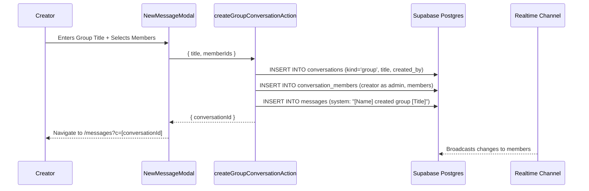
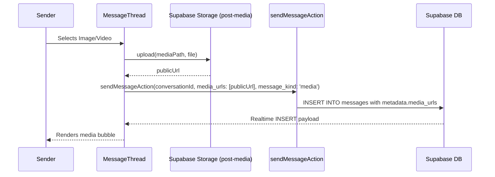

# Sub-Project 3: Realtime Direct Messaging & Group Chat — Design Spec

> WhatsApp / Messenger Core — Caribbean Futurism Edition

## Status: READY FOR IMPLEMENTATION

---

## 1. Situation Analysis & Existing Assets

### What Already Exists (Strong Foundation)
- `@caribbean/messaging`: Complete domain contracts (`ConversationKind`, `ConversationCategory`, `MessageKind`, `MessageDraft`, `ConversationPolicy`, `ReceiptState`, `buildBusinessAiSystemPrompt`).
- Database schema: `conversations`, `conversation_members`, `messages`, `message_attachments`, `message_receipts`, `message_reactions`, `message_requests` — with comprehensive RLS policies (migration `00008_messaging.sql`).
- Server actions (`apps/web/src/lib/messaging/actions.ts`):
  - `sendMessageAction`: burst rate limiting, draft validation, block checking, storage offloading for voice notes, sequence numbers.
  - `shareToChatAction`: direct sharing of products, events, orders, posts into chat threads.
  - `markConversationReadAction`, `editMessageAction`, `deleteMessageAction`, `toggleMessageReactionAction`, `generateBusinessAiResponseAction`.
  - Canonical 1-on-1 direct conversation resolution via `getOrCreateDirectConversation`.
- Client surfaces:
  - `MessagesCenterClient` (1095 LOC): Conversation list, unread badges, filter tabs (all, unread, marketplace, community, support), search, pending message requests drawer.
  - `MessageThread` (1097 LOC): Realtime Postgres change subscriptions, optimistic message reconciliation, voice note player/recorder, link preview detection, reaction popovers, WebRTC call HUD.
  - `NewMessageModal`: Member discovery and direct chat resolution.

### Gaps to Close for WhatsApp/Messenger Core Parity
1. **Group Chat Creation & Membership Actions**:
   - `createGroupConversationAction`: creates `kind: 'group'` conversation with title, sets creator as admin, adds initial members, logs system audit message.
   - `addGroupMembersAction`: adds new members to existing group with limit check (256 max).
   - `leaveGroupConversationAction`: marks `left_at: now()`.
2. **New Group Creation UI in `NewMessageModal`**:
   - Tab switcher between "Direct Message" and "Create Group".
   - Multi-select friend picking with badges/chips.
   - Group title input and validation.
3. **Media Attachment & File Upload in `MessageThread`**:
   - Add Paperclip / ImageIcon button in composer.
   - File picker supporting images and short video clips.
   - Upload pipeline to Supabase storage with preview card.
   - Render image/video previews inside message bubbles.
4. **Zero-Mock & Testing**:
   - Verify zero synthetic conversations.
   - Write unit tests for group creation, membership policies, and media sending.
   - Monorepo typecheck (31/31 packages).

---

## 2. Technical Architecture

### Group Chat Lifecycle

### Media Attachment Sending

---

## 3. Tasks Breakdown

- **Task 1**: Add `createGroupConversationAction`, `addGroupMembersAction`, and `leaveGroupConversationAction` in `apps/web/src/lib/messaging/actions.ts`.
- **Task 2**: Upgrade `NewMessageModal` with Group Chat creation mode (title input, member selection, group launch).
- **Task 3**: Add media attachment upload (Paperclip button + image/video preview in bubbles) in `MessageThread`.
- **Task 4**: Unit tests covering group creation, membership limits, media attachments, and leave group.
- **Task 5**: Zero-mock audit and monorepo typecheck verification.
