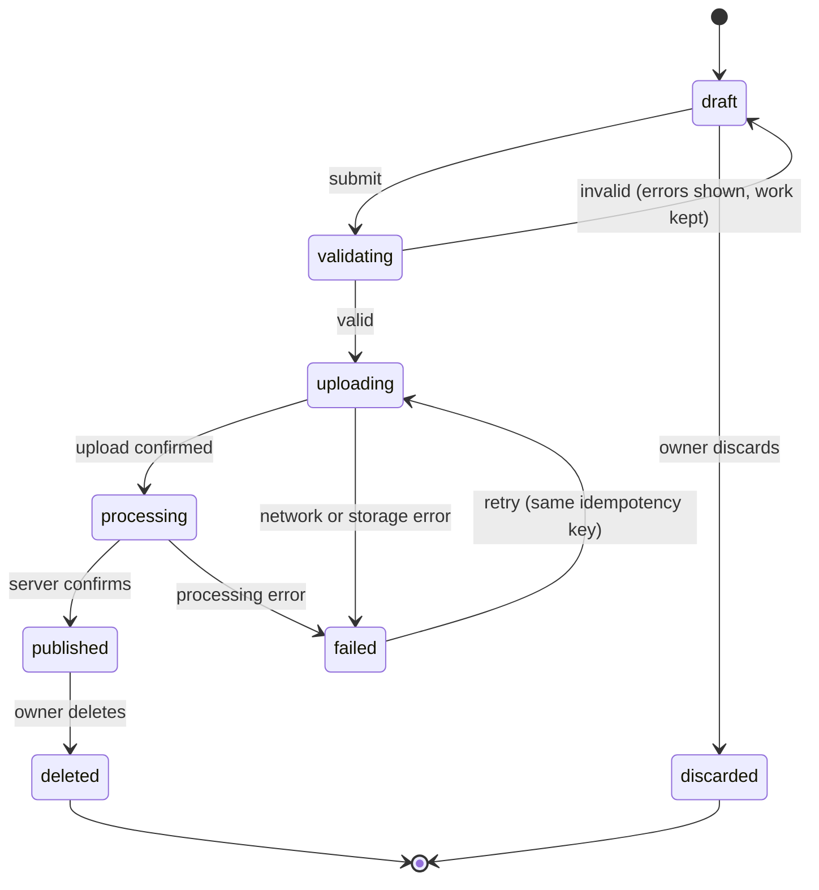
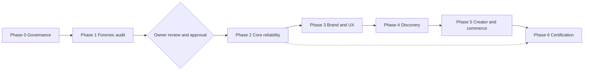

# TUKUBI-RTP-001 — Reimagination & Transformation Master Plan

| Field | Value |
| :--- | :--- |
| Document ID | TUKUBI-RTP-001 |
| Version | 1.0 (DRAFT — awaiting owner approval of §11 decisions) |
| Date | 2026-10-12 |
| Status | Governing specification for transforming the **existing** TUKUBI platform |
| Precedence | `AGENTS.md` (inviolable mandates) → **this plan** → ADRs (`docs/adr/`) → role protocols (`.agents/agents/`) → workflows/policies |
| Companion | [`TUKUBI-ANTIGRAVITY-MASTER-PROMPT.md`](./TUKUBI-ANTIGRAVITY-MASTER-PROMPT.md) — the operational prompt that executes this plan |

> **Governing principle.** Preserve everything that works. Repair everything that does not. Improve everything that can be better. Add only what strengthens TUKUBI's mission. Never sacrifice production stability to chase new features.

> [!IMPORTANT]
> Status discipline: every fact in this document is marked **VERIFIED** (observed in the repository on 2026-10-12, with the command or file cited), **CLAIMED** (stated by a prior document but not re-verified), or **PROPOSED** (a recommendation requiring approval). Nothing PROPOSED may be implemented until approved. (AGENTS.md Mandate 10.)

---

## 1. Mission & product identity

**Mission.** Transform TUKUBI into the digital home of the Caribbean, a secure, reliable, premium, Caribbean‑first platform connecting people, culture, creators, communities, businesses, and the diaspora. Preserve all valid existing functionality and data while doing it.

| Element | Authoritative value |
| :--- | :--- |
| Name | **TUKUBI** |
| Primary tagline | **The Caribbean Connected.** |
| Positioning | **Born in the Caribbean. Built for the World.** |
| Default experience | **Island Vibes** (`DEFAULT_THEME = 'island-vibes'` — VERIFIED, `packages/design-system/src/index.ts`) |
| Design language | Caribbean Futurism (VERIFIED, `DESIGN-SYSTEM.md` §1) |
| Website | https://www.tukubi.com/ |

**Binding exclusions:** do not revive Antilia, Caribbean One, or other retired branding. Do not use "TUKUBI Ecosystem" as the primary brand name. Do not reintroduce retired payment brand names as an active product. No fake users, fabricated engagement, mock production content, or false financial metrics. Keep the tiered creator subscriptions and services model with centralized entitlements, with no silent switch to platform commissions. Keep the current authentication approach, and introduce no mandatory email verification without approval.

**Design principle:** *familiar enough to use immediately, different enough to remember.*

---

## 2. Verified baseline (2026-10-12)

| Fact | Value | Evidence |
| :--- | :--- | :--- |
| Baseline commit | `a63bacb` (`fix(media): add optional siteName…`) | `git log -n 5` |
| Working tree | Clean | `git status --short` returned no entries |
| Apps | `web`, `mobile`, `admin`, `moderation`, `creator-studio`, `business-studio` | `apps/` listing |
| Packages | 25 under `packages/` (advertising, ai, analytics, api, auth, business, communities, creator, database, design-system, jobs, live, localization, marketplace, media, messaging, notifications, payments, podcasts, recommendations, sdk, search, social, trust-safety, ui) | `packages/` listing |
| Web pages | 115 `page.tsx` files | recursive count, `apps/web/src/app` |
| Web API routes | 38 `route.ts` files | recursive count |
| Migrations | 108 files in `supabase/migrations/` | file count |
| Edge Functions | `compute-trending`, `reconcile-daily` | `supabase/functions/` |
| Test files tracked | 209 `*.spec|test.ts(x)` | `git ls-files` |
| Hard-coded hex colors in web `.tsx` | 719 occurrences | `Select-String '#[0-9A-Fa-f]{6}'` |
| Dev-port collision | `creator-studio` **and** `moderation` both `next dev --port 3002` | each `package.json` |
| Missing role protocol | `.agents/agents/security.md` is referenced by `AGENTS.md` but **does not exist** | `.agents/agents/` listing (13 files; AGENTS.md says 14) |
| Tracked data file | `.agents/backup-legacy-posts-2026-09-01.json` (5.3 KB) is committed | `git ls-files` (contents must be reviewed for personal data, see R‑05) |
| `.env.local` | Present locally, git-ignored, not tracked | `git check-ignore` |

**Prior reports are claims, not evidence.** `AUDIT/` contains more than 80 reports, several of which claim full or "100%" production readiness (for example `36_MASTER_100_PERCENT_PRODUCTION_MATURITY_REPORT.md` and `35_FINAL_PRODUCTION_CERTIFICATION_REPORT.md`). Publishing and draft-reminder defects were nevertheless reported by the owner afterward. Every prior certification therefore has status **CLAIMED** until Phase 1 re-verifies it. Prior reports must **not** be deleted. Phase 1 indexes them and marks each one as superseded or confirmed.

---

## 3. Brand reconciliation: Island Vibes, evolved (not replaced)

### 3.1 What exists today (VERIFIED)

| Token | Hex | Role today |
| :--- | :--- | :--- |
| Twilight | `#110D17` | Canvas (dark, default) |
| Dusk | `#1D1429` | Surface |
| Sunset Plum | `#2A1B38` | Raised surface |
| **Sunrise Coral** | `#FF7A59` | Primary action |
| Sunset Purple | `#8B5CF6` | Secondary |
| Golden Hour | `#FFB347` | Accent / warning |
| **Caribbean Sea** | `#00B4D8` | Sea accent |
| **Sandstone** | `#FDF2E9` | Primary text (warm ivory) |
| Ocean Surge | `#0284C7` | Deep blue accent |
| Palm Green | `#10B981` | Success |
| Danger | `#F43F5E` | Danger |
| Fonts | Plus Jakarta Sans (heading), Inter (body), JetBrains Mono | — |

### 3.2 Mapping the "reimagined" direction onto the existing brand

| Reimagined idea | Existing equivalent | Decision (PROPOSED) |
| :--- | :--- | :--- |
| Warm ivory foundation | **Sandstone `#FDF2E9`** already exists | **Keep.** Promote it to the light-theme canvas. No new color. |
| Caribbean turquoise | **Caribbean Sea `#00B4D8`** already exists | **Keep.** Add a darker companion for text on light surfaces (see 3.4). |
| Coral accent | **Sunrise Coral `#FF7A59`** already exists | **Keep as primary.** Fix label contrast (see 3.3). |
| Deep ocean navy | No navy today; the dark base is Twilight (a purple-black) | **Add "Ocean Depth" (candidate `#0B1F33`)** as light-theme ink and as an optional *Deep Ocean* dark variant. **Twilight remains the Island Vibes default.** |
| Sunset/twilight purples, golden hour | Present | **Keep** for brand moments (gradients, onboarding, creator heroes), used selectively. |

### 3.3 Contrast audit of current tokens (VERIFIED — WCAG 2.x formula, scratch script)

| Pair | Ratio | AA verdict |
| :--- | :--- | :--- |
| Sandstone text on Twilight | 17.42 | ✅ |
| Muted `#A1A1AA` on Twilight | 7.49 | ✅ |
| Sunrise Coral on Twilight | 7.48 | ✅ |
| Caribbean Sea on Twilight | 7.79 | ✅ |
| Golden Hour on Twilight | 10.78 | ✅ |
| Sunset Purple on Twilight | 4.53 | ✅ (borderline) |
| **Dim `#71717A` on Twilight** | **3.97** | ❌ body text (large / non-essential only) |
| **Dim `#71717A` on Plum** | **3.31** | ❌ body text |
| **Sandstone/white label on Sunrise Coral button** | **2.33** | ❌ fails even 3:1. At least 4 web files use `bg-[#FF7A59]` with `text-white` |
| Twilight label on Sunrise Coral button | 7.48 | ✅ **use this** |
| Sandstone label on Sunset Purple button | 3.84 | ⚠ large text / UI only |
| Twilight label on Caribbean Sea button | 7.79 | ✅ |

### 3.4 Proposed light theme, "Island Daylight" (PROPOSED, candidate values)

| Semantic token | Candidate | Contrast on Sandstone |
| :--- | :--- | :--- |
| `surface/canvas` | Sandstone `#FDF2E9` | — |
| `text/primary` | Ocean Depth `#0B1F33` | 15.15 ✅ |
| `text/muted` | `#52606D` | 5.86 ✅ |
| `action/link` | Deep Sea `#0E7490` | 4.86 ✅ (raw Caribbean Sea is 2.24 ❌) |
| `action/primary` text-on-light | Ember Coral `#C2410C` | 4.70 ✅ (raw Sunrise Coral is 2.33 ❌) |
| `action/primary` filled button | Sunrise Coral fill + Ocean Depth label | 6.50 ✅ |

> [!NOTE]
> Candidate values are design-exploration proposals, not official brand colors. The Brand & UX agent must validate them against the logo, live screens, and owner preference before adoption (Decision D‑01).

### 3.5 Usage rules (PROPOSED)

1. About 60% neutral surfaces, 30% supporting tones, and no more than 10% expressive accent. Sunset gradients (`islandVibesHeader`) are reserved for brand moments, not every card.
2. Use real Caribbean photography and avoid generic beach clichés (DESIGN-SYSTEM.md §1).
3. Every color is consumed through semantic tokens. Migrate the 719 hard-coded hex values in incremental, screen-scoped batches with visual-regression evidence, never in one global sweep.
4. Users may personalize their theme, but the TUKUBI wordmark, tagline hierarchy, and semantic feedback colors never change.

---

## 4. Product architecture: five connected pillars

| Pillar | Scope | Existing surface (VERIFIED routes / packages) |
| :--- | :--- | :--- |
| 1. People & Community | Profiles, graph, feed, comments, reactions, messaging, notifications, groups, pages | `home`, `feeds/[tab]`, `profile/[username]`, `friends`, `people`, `members`, `messages`, `notifications`, `communities`, `pages`, `saved` · packages `social`, `messaging`, `notifications`, `communities` |
| 2. Caribbean Discovery | Explore by island/country/language/culture, search, SEO-eligible public pages | `explore`, `explore/[slug]`, `explore/diaspora`, `explore/vibe`, `caribbean`, `diaspora`, `map`, `search`, `learn`, `embed/[type]` · packages `search`, `recommendations`, `localization` |
| 3. Media & Creators | Photos, video, embeds, audio, podcasts, reels, sounds, live, Creator Hub/Studio, analytics | `create`, `reels`, `sounds/[id]`, `podcast(s)`, `live`, `live/broadcast`, `creator-hub`, `creator-studio/*`, `creator-marketplace` · apps `creator-studio` · packages `media`, `creator`, `podcasts`, `live` |
| 4. Commerce & Opportunity | Business pages, marketplace, stores, events, tickets, subscriptions, financial center | `marketplace/*`, `store/[slug]`, `merchant`, `events`, `financial-center/*`, `ads` · apps `business-studio` · packages `marketplace`, `business`, `payments`, `advertising` |
| 5. Intelligence & Connection | Translation, recommendations, search, spam/abuse detection, insights | `api/translate`, `api/discovery`, `labs` · packages `ai`, `recommendations`, `trust-safety`, `analytics` |
| Cross-cutting | Trust & Safety, admin, help, recognition, relief, onboarding, offline | `admin/*`, `moderation/*`, `moderator`, `help`, `recognition/*`, `relief`, `onboarding`, `signup/*`, `offline`, `privacy`, `terms` · apps `admin`, `moderation` |

All pillars share **one** identity, permission model, media pipeline, search index, notification system, and analytics taxonomy.

**Navigation (PROPOSED, see Decision D‑02).** The mobile tab bar has five destinations. Desktop uses a three-column layout: left nav, center feed and composer, right discovery rail (existing `--sidebar-w: 260px`, `--rail-w: 340px`). Messages, notifications, search, and settings stay reachable from the header.

---

## 5. Architecture standards

Keep the **modular monolith** (ADR‑003), **Supabase/PostgreSQL** (ADR‑002), and the **monorepo** (ADR‑001). Do not introduce microservices, Kubernetes, new databases, brokers, or providers without a new ADR justifying them.

Enforced principles:

1. **One authoritative data model** per business concept. Phase 1 identifies overlapping tables, which are reconciled through additive migrations only.
2. **One permission model.** RLS on every client-reachable table (Mandate 2). The same rules apply across queries, APIs, Storage, and Realtime channels. `SECURITY DEFINER` functions have a pinned `search_path` and are reviewed.
3. **One publishing lifecycle**, specified in §6.
4. **Double-entry ledger** for every monetary movement, with idempotency keys and never `balance = balance + x` (Mandate 3).
5. **Controlled schema evolution.** Versioned migrations only, reviewed for dependencies, backward compatibility, and a stated rollback or forward-fix.
6. **Observable behavior.** Sentry and PostHog (CLAIMED in the Phase‑0 baseline) must be able to distinguish UI failures, API failures, authorization denials, storage errors, database errors, and third-party outages.
7. **No service-role key in client bundles**, verified by a build-artifact scan in Phase 2.

---

## 6. Publishing & media reliability standard (first system to perfect)

### 6.1 Lifecycle

### 6.2 Acceptance rules

1. Show success **only** after the server confirms. While processing, show a truthful pending state.
2. Every publish carries a client-generated **idempotency key**, so retries never create duplicate posts.
3. Drafts persist server-side or in durable local storage. A dropped connection never loses the user's work.
4. A draft reminder is derived from persisted draft state and clears when the draft is published or discarded, on every device and tab.
5. Link enrichment does not block publication (an existing pattern: commit `fe2f858` decoupled publication from media resolution).
6. Provider-aware embed layer (existing `RichMediaPlayer` with YouTube error trapping, commit `6b3a0f6`):

| Source | Required behavior |
| :--- | :--- |
| Uploaded images | Reliable upload, derivatives per `ASPECT_RATIOS`, display |
| Uploaded video | Processing state, playback, poster, fallback |
| YouTube | Inline embed where permitted; fall back on embed-disabled errors |
| Instagram / TikTok / Facebook / X | Official embed only where the provider permits; otherwise a link card |
| Audio / podcasts | Supported player or a clear link fallback |
| Unsupported or restricted | Useful link card, an explanation, and an "Open on {provider}" action |

7. Embeds are sandboxed (`iframe sandbox`, a CSP `frame-src` allow-list, `referrerpolicy`), and no third-party script runs in the first-party origin.

**Acceptance standard:** a user never has to wonder whether a post was published, why it failed, whether content was lost, or why a stale draft warning will not disappear.

---

## 7. Feature Preservation Register (seed)

Phase 1 expands this into `TUKUBI_FEATURE_PRESERVATION_REGISTER.md` with one row per feature, recording: ID · route/entry · intended behavior · frontend · backend/DB deps · authZ/privacy · **status** · evidence · risks · action (`PRESERVE | REPAIR | REFACTOR | REDESIGN | EXPAND | DEPRECATE | INVESTIGATE`).

Every row starts as **UNVERIFIED**. A visible button, route, or table is not proof of a working feature.

| Area | Seed entry points (VERIFIED to exist as routes/apps) | Initial action |
| :--- | :--- | :--- |
| Identity & onboarding | `login`, `signup/{account,caribbean,interests,complete}`, `forgot-password`, `reset-password`, `auth/callback`, `onboarding`, `settings` | INVESTIGATE |
| Home & feeds | `home`, `feeds/[tab]`, `post/[id]`, `saved` | INVESTIGATE → REPAIR (publishing) |
| Social graph | `friends`, `people`, `members`, `profile/[username]` | INVESTIGATE |
| Publishing & media | `create`, `reels`, `sounds/[id]`, `api/oembed`, `embed/[type]` | **REPAIR (P0)** |
| Messaging | `messages`, `messages/[username]` | INVESTIGATE |
| Notifications | `notifications` | INVESTIGATE |
| Discovery | `explore/*`, `caribbean`, `diaspora`, `map`, `search`, `learn/[category]`, `api/discovery` | INVESTIGATE |
| Communities & pages | `communities/*`, `pages/*` | INVESTIGATE |
| Events & relief | `events`, `relief` | INVESTIGATE |
| Creators | `creator-hub`, `creator-studio/{monetization,repurpose,videos}`, `creator-marketplace`, `podcast(s)`, `live/*`, app `creator-studio` | INVESTIGATE |
| Commerce | `marketplace/{[id],disputes,offers,orders,seller-center,wishlist}`, `store/[slug]`, `merchant`, app `business-studio` | INVESTIGATE |
| Payments & financial center | `financial-center/*` (11 subroutes), `api/payments`, `api/webhooks`, Edge Function `reconcile-daily` | INVESTIGATE (Payments review chain) |
| Advertising | `ads`, `ads/new`, `api/ads`, package `advertising` | INVESTIGATE → **freeze expansion** (D‑04) |
| Trust & Safety / admin | `admin/*` (10 subroutes), `moderation/*`, `moderator/signup`, apps `admin`, `moderation` | INVESTIGATE |
| Recognition | `recognition/{achievements,hall-of-fame}`, `api/recognition` | INVESTIGATE |
| AI & translation | `api/translate`, `labs`, package `ai` | INVESTIGATE |
| Help, legal, offline | `help/*`, `privacy`, `terms`, `offline` | INVESTIGATE |
| Mobile app | `apps/mobile` (17 screens CLAIMED) | INVESTIGATE |
| Public API | `api/v1` | INVESTIGATE |

**Relocation rule:** if the redesign moves a feature, record its old route, new route, permissions, dependencies, and redirects. No route may 404 as a side effect of navigation changes.

---

## 8. Additions that the draft vision did not cover

| # | Addition | Why |
| :--- | :--- | :--- |
| A‑01 | **Six locales, not four**: `en, es, fr, ht, nl, pap` | Already specified in DESIGN-SYSTEM.md §5. Covers Aruba, Curaçao, Bonaire, Sint Maarten, and Suriname. |
| A‑02 | **Low-bandwidth mode** (data saver: no autoplay, low-res derivatives, deferred embeds) | Many users are on mid-range Android over metered connections |
| A‑03 | **Copyright & licensing** for `sounds`, `reels`, and podcasts: DMCA/notice-and-takedown, repeat-infringer policy | Music-heavy features carry legal risk |
| A‑04 | **Account deletion & data export** reachable in-app | App Store and Play requirement; privacy law |
| A‑05 | **Privacy-law map**: Caribbean data-protection acts, GDPR (EU diaspora/French territories), CCPA | Diaspora participation crosses jurisdictions |
| A‑06 | **Minor safety & age gating** | Required before broad public growth |
| A‑07 | **Feature flags and kill switches** for every Phase 2+ change | Enables staged rollout and instant rollback |
| A‑08 | **Incident response runbook and status communication** | Reliability is part of the product |
| A‑09 | **Cost governance**: per-provider usage and free-tier limits (Supabase, Vercel, OpenRouter, storage egress) | Sustainable business pillar |
| A‑10 | **Prior-audit reconciliation**: index the 80+ `AUDIT/` reports as confirmed or superseded | Ends contradictory "100%" claims |
| A‑11 | **Create `.agents/agents/security.md`** plus missing roles (Media & Publishing, Brand & UX, Release) | Fixes broken governance references |
| A‑12 | **Resolve the port-3002 collision** between `creator-studio` and `moderation` | Local and CI reliability |
| A‑13 | **Review the tracked `backup-legacy-posts-*.json`** for personal data, and relocate it if needed (non-destructively, with owner approval) | Data-handling hygiene |
| A‑14 | **Accessibility contrast fixes** from §3.3 | WCAG 2.2 AA is part of the Definition of Done |
| A‑15 | **Analytics event taxonomy** for the §10 scorecard, privacy-preserving | Measures value, not vanity |
| A‑16 | **SEO for eligible public pages** (creator, business, island/topic pages) with strict privacy exclusions | Discovery pillar |

---

## 9. Phased program, subagent ownership, and gates

Logical agents map onto the **existing** role protocols in `.agents/agents/`. New protocols are marked ➕.

| Agent | Role | Protocol file |
| :--- | :--- | :--- |
| A | Chief Orchestrator & Principal Architect | `chief-architect.md` |
| B | Product & Forensic Audit | `product.md` |
| C | Database & Supabase | `database.md` |
| D | Security & Privacy | ➕ `security.md` |
| E | Brand, UX/UI & Accessibility | ➕ `brand-ux.md` (+ `frontend.md`) |
| F | Frontend & Application | `frontend.md`, `mobile.md` |
| G | Backend & Integrations | `backend.md`, `ai.md` |
| H | Media & Publishing | ➕ `media-publishing.md` |
| I | Independent QA | `qa.md` |
| J | Performance, SRE & Operations | `performance.md`, `devops.md` |
| K | Creator, Commerce & Monetization | `payments.md` |
| L | Documentation & Release | ➕ `release-manager.md` |
| — | Trust & Safety, Analytics | `trust-safety.md`, `analytics.md` |

| Phase | Priority | Lead | Specialists | Key deliverables | Exit gate |
| :--- | :--- | :--- | :--- | :--- | :--- |
| 0 Governance | P0 | A | B, C, J, L | Baseline, environment inventory, recovery verification, registers, change control | Recovery boundaries known; missing protections escalated |
| 1 Forensic audit | P0 | A | B, C, D, E, F, G, H, I, J (all **read-only**) | 11 audit artifacts (§12), Product Truth Matrix, backlog | Findings reproducible; owner approves backlog |
| 2 Core reliability | P0 | A | H, G, C, D, F, I | §6 lifecycle, auth/feed/messaging/notification fixes, RLS fixes, contrast P0s | Critical journeys pass E2E; no open critical security issue; preserved features still work |
| 3 Brand & UX | P1 | E | F, I, J | Token reconciliation, screen redesigns (Home → Create → Explore → Profile/Community → Messages → Creator Hub) | Approved system implemented; visual and a11y regression green |
| 4 Discovery | P1 | B | G, F, C, D | Island/topic pages, cross-entity search, locales, SEO | Works with real data; privacy verified |
| 5 Creator & commerce | P2 | K | G, D, I, C | Creator Hub, entitlements, marketplace, events, reconciliation | Each capability passes functional, security, and financial gates |
| 6 Certification | P0 | I (independent) | D, J, L | Full regression, readiness report, GO/NO‑GO | Explicit GO with evidence |

**Coordination rules.** One accountable owner per shared module. No two agents edit the same file or migration concurrently. Serialize schema, global styles, auth, payments, and shared contracts. Read-only audit work runs in parallel. The implementing agent never certifies its own work (Agent I or D verifies). Agents stop and escalate on unsafe dependencies, missing credentials, production discrepancies, or security concerns.

**Gate statuses:** **GREEN** = mandatory criteria met with evidence. **YELLOW** = only independent, safe work may proceed, and nothing affected can be certified. **RED** = stop the affected work.

---

## 10. Measurement scorecard (baselines first, targets after)

| Dimension | Signal |
| :--- | :--- |
| Activation | % of new users who complete profile, select interests, and make a first meaningful interaction within the first session |
| Retention | D1 / D7 / D30 return with a meaningful action |
| Publishing reliability | Publish success rate, p50/p95 time-to-confirmed, retry rate, duplicate rate (target 0), support interventions |
| Community health | Creators receiving engagement, community growth, report/appeal rates |
| Sustainable business | Creator and business value realized, cost per active user |

No targets are invented. Phase 1 measures baselines, and the owner then approves targets.

---

## 11. Owner Decisions (APPROVED 2026-10-12)

| ID | Decision | Approved Resolution |
| :--- | :--- | :--- |
| D‑01 | Adopt Ocean Depth (`#0B1F33`) and the Island Daylight light theme (§3.4) while preserving Island Vibes (`#110D17`) as the default theme | **APPROVED** |
| D‑02 | Mobile tab bar persistent destinations | **APPROVED:** *Home · Explore · Create · Community · Profile* (with Messages, Notifications, Search, and Settings accessible in the persistent header) |
| D‑03 | Authorize Phase 2+ execution after forensic audit synthesis | **APPROVED** |
| D‑04 | Advertising platform: freeze expansion (preserve existing routes/logic) until core KPIs justify it | **APPROVED (Freeze expansion, preserve existing)** |
| D‑05 | Where prior `AUDIT/` reports live after reconciliation | **APPROVED:** Keep in place and index in `docs/transformation/TUKUBI_PRIOR_AUDIT_INDEX.md` |
| D‑06 | Access model for agents | **APPROVED:** Full access throughout the workspace and tools, governed by Phase gates and non-destructive rules |

---

## 12. Required artifacts (`docs/transformation/`)

`TUKUBI_FEATURE_PRESERVATION_REGISTER.md` · `TUKUBI_SYSTEM_ARCHITECTURE.md` · `TUKUBI_DATABASE_AND_MIGRATION_AUDIT.md` · `TUKUBI_SECURITY_AND_PRIVACY_AUDIT.md` · `TUKUBI_BRAND_AND_DESIGN_SYSTEM.md` · `TUKUBI_UX_AND_ACCESSIBILITY_AUDIT.md` · `TUKUBI_MEDIA_AND_PUBLISHING_SPEC.md` · `TUKUBI_TEST_AND_RELEASE_STRATEGY.md` · `TUKUBI_PRODUCT_TRUTH_MATRIX.md` · `TUKUBI_MARKETING_TRUTH_MATRIX.md` · `TUKUBI_RISK_AND_DEPENDENCY_REGISTER.md` · `TUKUBI_ARCHITECTURE_DECISIONS.md` (index into `docs/adr/`; new ADRs go there) · `TUKUBI_IMPLEMENTATION_BACKLOG.md` · `TUKUBI_PRIOR_AUDIT_INDEX.md` · `TUKUBI_RELEASE_READINESS_REPORT.md`.

Where an existing document already covers a topic (for example `docs/infrastructure/rls.md` or `docs/operations/DISASTER-RECOVERY.md`), the artifact **links to it and records deltas** rather than duplicating it.

---

## 13. Initial risk register

| ID | Risk | Sev | Mitigation owner |
| :--- | :--- | :--- | :--- |
| R‑01 | Publishing/draft defects erode user trust | Critical | H, Phase 2 |
| R‑02 | Prior "100%" certifications mask real defects | High | B, Phase 1 |
| R‑03 | 108 migrations may diverge from production schema | High | C, Phase 1 |
| R‑04 | Primary-button contrast fails WCAG (2.33:1) | High | E, Phase 2 |
| R‑05 | Tracked legacy-posts backup may contain personal data | Medium (unverified) | D, Phase 0 |
| R‑06 | Missing `security.md` protocol weakens review chain | Medium | A, Phase 0 |
| R‑07 | 719 hard-coded colors make theme changes risky | Medium | E/F, Phase 3 |
| R‑08 | Port collision causes flaky local/CI runs | Low | J, Phase 0 |
| R‑09 | Agents acting on untrusted repo text (prompt injection) | High | A, all phases |

---

## 14. Definition of Done (extends AGENTS.md Mandate 6)

Previous behavior is documented. Dependencies are mapped. Implementation is reviewed. AuthZ/RLS is verified. Unit, integration, and E2E tests pass, and skipped is never passed. Desktop and mobile are verified. Loading, empty, error, offline, and recovery states exist. WCAG 2.2 AA is checked. Analytics events and structured logs exist. Feature-flagged where applicable. The register and truth matrices are updated. No regressions. Every reviewed change carries **WHAT CHANGED / WHY / FILES CHANGED / TESTS RUN / SECURITY IMPACT / PERFORMANCE IMPACT / DATABASE IMPACT / ROLLBACK PLAN**.

> *Preserve what works. Fix what fails. Improve what matters. Prove what you deliver. Protect the platform throughout the process.*
