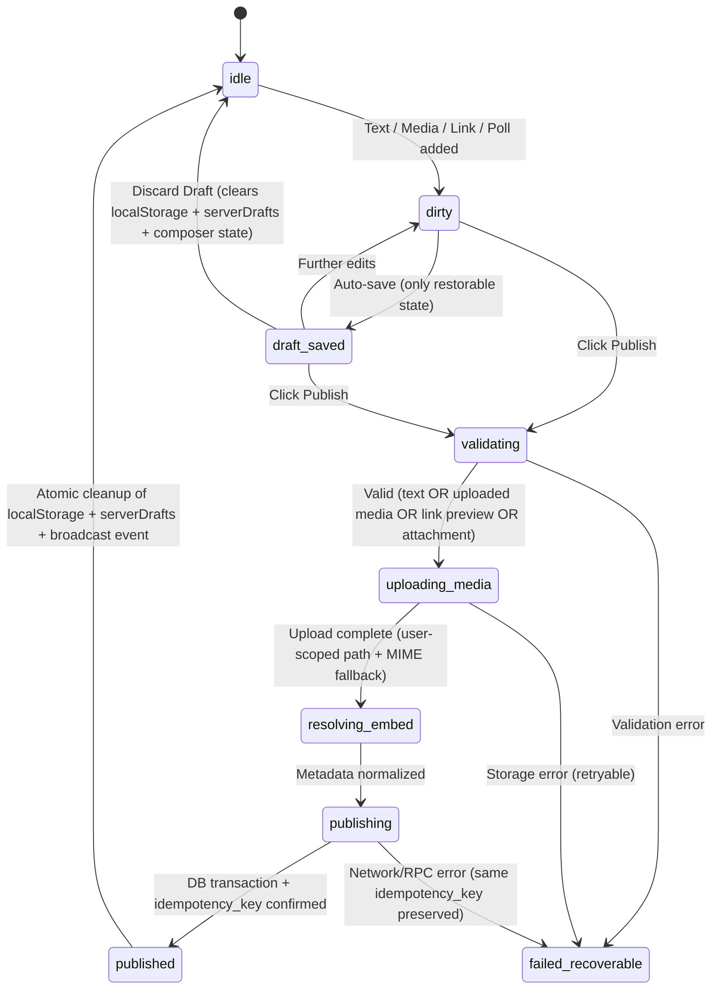

# TUKUBI Unified Media & Publishing Specification (`TUKUBI_MEDIA_AND_PUBLISHING_SPEC.md`)

**Program:** `TUKUBI-RTP-001` (Phase 1 Forensic Root-Cause Analysis & Phase 2 Architecture Specification)  
**Date:** 2026-10-12  
**Priority:** **P0 — Owner-Reported Production Defects**  
**Scope:** `apps/web/src/components/universal-composer.tsx`, `apps/web/src/components/create-hub-client.tsx`, `apps/web/src/lib/social/draft-manager.ts`, `apps/web/src/lib/social/posting-state-machine.ts`, `apps/web/src/lib/social/actions.ts`, `apps/web/src/components/media/rich-media-player.tsx`, `apps/web/src/app/api/v1/media/resolve-url/route.ts`, `apps/web/next.config.js`, `packages/media/src/url-resolver.ts`, `supabase/migrations/00089..00107`

---

## 1. Forensic Root-Cause Findings (Why Owner-Reported Bugs Occurred)

### Defect P0-PUB-01: YouTube & External Video Embeds Blocked by Content-Security-Policy (`apps/web/next.config.js:21`)
- **Verified Code Fact:** `TUKUBI_CSP` in [apps/web/next.config.js](file:///c:/Users/Owner/Desktop/social%20media%20platform/apps/web/next.config.js#L21) defines:
  ```js
  "frame-src 'self' https://js.stripe.com https://hooks.stripe.com https://www.paypal.com https://www.sandbox.paypal.com"
  ```
- **Root Cause:** Although `packages/media/src/url-resolver.ts` (`lines 19–33`) defines `ALLOWED_EMBED_ORIGINS` (`https://www.youtube.com`, `https://www.youtube-nocookie.com`, `https://player.vimeo.com`, `https://www.dailymotion.com`, `https://player.twitch.tv`, `https://clips.twitch.tv`, `https://www.loom.com`, `https://open.spotify.com`, `https://w.soundcloud.com`, `https://embed.podcasts.apple.com`, `https://embed.music.apple.com`, `https://www.tiktok.com`), none of those origins were added to `frame-src` in `TUKUBI_CSP`. Every browser with CSP enabled blocks the embed `<iframe>` immediately.
- **Thumbnail CSP & Image Optimizer Gap (`apps/web/next.config.js:15, 62–99`):** `img-src` and `images.remotePatterns` also omit `https://i.ytimg.com` and `https://img.youtube.com` (the domains returned by `resolveYouTubeMetadata` in `packages/media/src/url-resolver.ts:289` for YouTube video thumbnails).

### Defect P0-PUB-02: `RichMediaPlayer` 4.5-Second Watchdog Self-Destructs Every Video (`apps/web/src/components/media/rich-media-player.tsx:148–155, 194–204`)
- **Verified Code Fact:** When a user clicks Play on an embedded video card in [rich-media-player.tsx](file:///c:/Users/Owner/Desktop/social%20media%20platform/apps/web/src/components/media/rich-media-player.tsx#L148-L155):
  1. `handlePlayClick` sets `playerState` to `'loading'` and starts a `4500ms` timeout (`timeoutRef.current = setTimeout(() => triggerFallback('Playback timed out inside platform container.'), 4500)`).
  2. The timer is only cleared if `window` receives a `message` event from `youtube.com` containing `event: "onStateChange"` or `"onReady"` (`lines 118–124`).
  3. However, the `<iframe ref={iframeRef}>` (`lines 194–204`) has **no `onLoad` handler**, and never sends the mandatory YouTube IFrame API handshake `{"event":"listening","id":1,"channel":"widget"}` via `iframeRef.current.contentWindow.postMessage(...)`.
- **Root Cause:** Without the `listening` postMessage handshake after `onLoad`, YouTube's embed player never emits `onReady` or `onStateChange` events to the parent window. And non-YouTube providers (Vimeo, TikTok, Dailymotion) do not emit YouTube's JSON message format at all. Consequently, **100% of embedded videos time out after 4.5 seconds** and replace the playing video with `"Playback unavailable in embed"`.

### Defect P0-PUB-03: Link-Preview & Rich-Attachment Posts Without Body Text Rejected by Server Validation (`apps/web/src/lib/social/actions.ts:110–119`)
- **Verified Code Fact:** In `UniversalComposer` ([universal-composer.tsx](file:///c:/Users/Owner/Desktop/social%20media%20platform/apps/web/src/components/universal-composer.tsx#L921)), the Publish button is enabled when `hasContent || hasMedia || hasLinkPreviews || hasPoll || hasEvent || hasFundraiser || hasProducts`.
- **Root Cause:** In `createPostAction` ([actions.ts](file:///c:/Users/Owner/Desktop/social%20media%20platform/apps/web/src/lib/social/actions.ts#L110-L119)), `validateComposer({ content, mediaCount: mediaUrls.length })` is called *before* `link_previews` is parsed on line 142. If a user pastes a YouTube/external URL, resolves the link preview card, and deletes the raw URL text from the textarea (or publishes a poll/event/product post with empty `content` and no uploaded file in `mediaUrls`), `validateComposer` fails with `"Post must contain text or media"`.

### Defect P0-PUB-04: Discarded Drafts Resurrected by `UniversalComposer` Auto-Save (`apps/web/src/components/universal-composer.tsx:39, 363–397, 441–482`)
- **Verified Code Fact:** `UniversalComposer` imports `subscribeToDraftChanges` on line 39 of [universal-composer.tsx](file:///c:/Users/Owner/Desktop/social%20media%20platform/apps/web/src/components/universal-composer.tsx#L39) but **never invokes it**.
- **Root Cause:** When a user visits `/create`, `CreateHubClient` ([create-hub-client.tsx](file:///c:/Users/Owner/Desktop/social%20media%20platform/apps/web/src/components/create-hub-client.tsx#L317-L369)) displays the amber draft reminder banner, while `UniversalComposer` simultaneously restores the draft into its React state (`content`, `resolvedLinkPreviews`, `mediaList`, etc.). When the user clicks **"Discard Draft"** on the banner in `CreateHubClient`, `clearComposerDraft()` deletes the `localStorage` entry and dispatches `tukubi:composer-draft-cleared`. Because `UniversalComposer` is not subscribed to `subscribeToDraftChanges`, its React state still holds the old draft, and its debounced auto-save `useEffect` (`lines 441–482`) **writes the discarded draft right back into `localStorage`**!

### Defect P0-PUB-05: Un-Uploaded Local Media & Server Drafts Create Un-Dismissable Ghost Reminders (`apps/web/src/lib/social/draft-manager.ts:39–55` & `create-hub-client.tsx:223, 317–369`)
- **Verified Code Fact 1 (`draft-manager.ts:45`):** `hasMeaningfulDraftContent` returns `true` whenever `draft.mediaSummary.length > 0`. However, when a user selects a local image/video without uploading or publishing, `UniversalComposer` saves `mediaSummary: [{ id, type, uploadedUrl: undefined }]`. On next mount (`universal-composer.tsx:379`), only items with `.filter((m) => m.uploadedUrl)` can be restored (`blob:` URLs do not survive page reloads). Thus `getComposerDraft()` keeps returning a "recoverable" draft with `uploadedUrl: undefined`, showing the abandoned draft banner forever even though resuming it restores nothing!
- **Verified Code Fact 2 (`create-hub-client.tsx:223, 348`):** `CreateHubClient` also checks `serverDrafts` (`creator_content_drafts` table) and sets `hasAnyDraft = (hasDraft || serverDrafts.length > 0) && !isDraftBannerDismissed`. However:
  - When `hasDraft` is `false` and `serverDrafts.length > 0`, the **"Discard Draft"** button is hidden (`{hasDraft && (<button onClick={handleDiscardLocalDraft}>...)}`), leaving no way to clear the server draft reminder.
  - Clicking "Discard Draft" or publishing a post in `UniversalComposer` never deletes/archives `serverDrafts`, so every reload of `/create` resurrects the banner.

---

## 2. Unified Publishing & Draft Lifecycle State Machine (Phase 2 Remediation Spec)



### Mandatory Phase 2 Implementation Rules
1. **CSP & Image Whitelist (`apps/web/next.config.js`):**
   - Add all `ALLOWED_EMBED_ORIGINS` to `frame-src` in `TUKUBI_CSP`.
   - Add `https://i.ytimg.com` and `https://img.youtube.com` to `img-src` and `images.remotePatterns`.
2. **Deterministic Embed Playback (`apps/web/src/components/media/rich-media-player.tsx`):**
   - Attach `onLoad` to the `<iframe ref={iframeRef}>` to clear `timeoutRef`, set `playerState('playing')`, and (for YouTube) post `{"event":"listening","id":1,"channel":"widget"}` to `iframeRef.current.contentWindow` so YouTube error codes (`100`, `101`, `150`) still trigger the clean external fallback link.
3. **Server Validation Parity (`apps/web/src/lib/social/actions.ts`):**
   - Parse `link_previews` and rich attachment flags (`poll_options`, `event_title`, `fundraiser_title`, `tagged_products`) *before* `validateComposer`, counting them toward `mediaCount` and providing a safe fallback string when `content` is empty so link-only and media-only posts succeed.
4. **Cross-Component Draft Synchronization (`draft-manager.ts`, `universal-composer.tsx`, `create-hub-client.tsx`):**
   - In `hasMeaningfulDraftContent` (`draft-manager.ts`), only count `mediaSummary` items that have a non-empty `uploadedUrl` (`draft.mediaSummary.some((m) => Boolean(m.uploadedUrl))`).
   - In `UniversalComposer`, subscribe to `subscribeToDraftChanges` and reset all composer fields when a external discard (`null` draft) occurs, preventing auto-save resurrection.
   - In `CreateHubClient`, allow discarding both local and server drafts (`creator_content_drafts`), and automatically clear active server drafts upon post publication.
