# TUKUBI System Architecture (`TUKUBI_SYSTEM_ARCHITECTURE.md`)

**Program:** `TUKUBI-RTP-001` (Phase 1 Forensic Architecture Baseline & Target Modular Monolith Specification)  
**Date:** 2026-10-12  
**Governing Principle:** Modular monolith with strict domain boundaries, one authoritative data model, one permission model (PostgreSQL RLS + server validation), one unified publishing lifecycle, and one source of truth.

---

## 1. High-Level Topology

```mermaid
flowchart TD
    subgraph Clients["TUKUBI Clients"]
        Web["apps/web (Next.js 15 App Router :3000)"]
        Mobile["apps/mobile (Expo / React Native)"]
        Admin["apps/admin (:3001) & apps/moderation (:3004)"]
    end

    subgraph AppLayer["Application & Security Layer"]
        MW["Middleware & Auth Gate (Supabase SSR + RBAC)"]
        RL["Rate Limiter (@caribbean/api + Upstash/Memory)"]
        CSP["Strict CSP + Embed Origin Whitelist + SSRF Guard"]
    end

    subgraph Domains["Modular Product Domains (packages/*)"]
        D1["Identity, Profiles & Geography (@caribbean/auth, @caribbean/geography)"]
        D2["Feed, Social Graph & Communities (@caribbean/social, @caribbean/communities, @caribbean/ranking)"]
        D3["Unified Media & Publishing (@caribbean/media, UniversalComposer, RichMediaPlayer)"]
        D4["Creator, Live, Podcasts & Commerce (@caribbean/creator, @caribbean/marketplace, @caribbean/events)"]
        D5["Financial Center & Double-Entry Ledger (@caribbean/payments, @caribbean/ledger)"]
        D6["Intelligence, Search & Safety (@caribbean/ai, @caribbean/search, @caribbean/trust-safety)"]
    end

    subgraph Infra["Shared Infrastructure (Supabase & Edge)"]
        PG["PostgreSQL 15+ (109 Versioned Migrations + Strict RLS)"]
        Storage["Supabase Storage (User-Scoped Bucket Policies)"]
        Realtime["Supabase Realtime (Scoped Channels)"]
        Edge["Supabase Edge Functions (compute-trending, reconcile-daily)"]
    end

    Clients --> AppLayer
    AppLayer --> Domains
    Domains --> Infra
```

---

## 2. Six-App Monorepo Consolidation & Port Map

| Workspace | Directory | Port | Architectural Role |
| :--- | :--- | :---: | :--- |
| `caribbean-web` | `apps/web` | `3000` (`3100` E2E) | **Primary Unified Platform** — houses all 5 connected pillars (Home/Social, Explore/Caribbean Discovery, Media/Creator Hub, Commerce/Events/Financial Center, Intelligence/Admin/Moderation). |
| `caribbean-admin` | `apps/admin` | `3001` | Dedicated administrative portal sharing `@caribbean/*` packages and Supabase RLS. |
| `caribbean-creator-studio` | `apps/creator-studio` | `3002` | Standalone creator shell; canonical DB-backed Creator Studio & Creator Hub live in `apps/web/src/app/creator-studio` and `/creator-hub`. |
| `caribbean-business-studio` | `apps/business-studio` | `3003` | Standalone merchant shell; canonical DB-backed Merchant Center lives in `apps/web/src/app/merchant` and `/marketplace/seller-center`. |
| `caribbean-moderation` | `apps/moderation` | `3004` | Dedicated Trust & Safety moderation portal (reassigned from port `3002` to eliminate port collision). |
| `caribbean-mobile` | `apps/mobile` | `8081` | Universal Expo React Native client sharing design tokens and Supabase backend. |

---

## 3. Five Architectural Invariants Enforced by `TUKUBI-RTP-001`

1. **One Authoritative Data Model:** All posts, media (`post_media`), external embeds (`post_external_media`), drafts (`creator_content_drafts`), and financial transactions (`ledger_accounts`, `ledger_entries`) use canonical tables in `public` schema with versioned migrations in `supabase/migrations/`.
2. **One Permission Model:** Client UI visibility is convenience only; every mutation is validated server-side and enforced by PostgreSQL Row Level Security (`auth.uid()`) and storage path enclosure (`(storage.foldername(name))[1] = auth.uid()::text`).
3. **One Unified Publishing Lifecycle:** Text, images, videos, audio, and external embeds (YouTube, Vimeo, TikTok, Spotify, SoundCloud) traverse a single deterministic state machine with author-scoped `idempotency_key` deduplication (`idx_posts_author_idempotency`) and synchronized client/server draft cleanup.
4. **Double-Entry Financial Integrity:** Every monetary mutation uses integer minor units (`price_minor`, `balance_minor`) and zero-sum ledger entries (`trg_ledger_sum_zero`).
5. **Truthful Degraded Modes:** When optional external services (OpenRouter AI, third-party oEmbed endpoints, or live streaming providers) are unreachable, the platform degrades deterministically (e.g., clean external link card fallback in `RichMediaPlayer`) without crashing or fabricating fake data.
